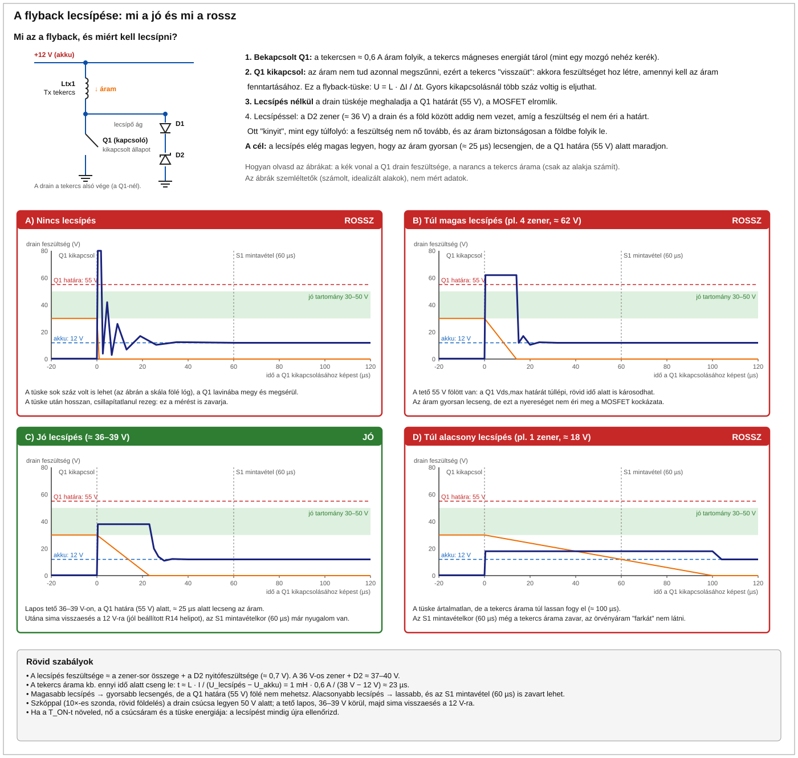
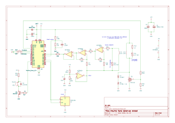
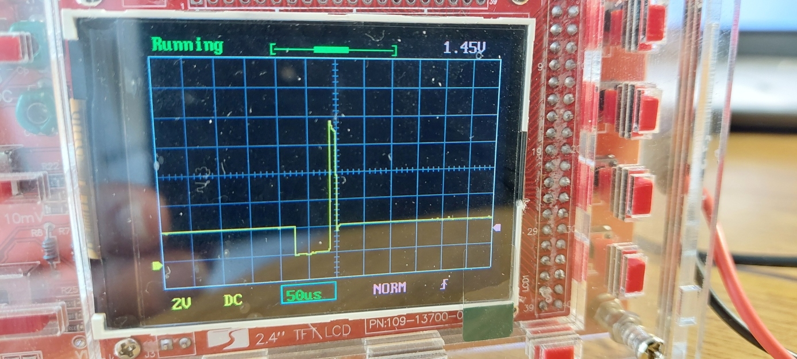

# Pulzusindukciós (PI) betonvas-kereső – Arduino Nano + DD tekercs + MCP6004 + IRLZ44N + SSD1306

Kézi betonvas-kereső, amely impulzusindukciós (PI) elven, két D alakú tekerccsel (DD elrendezés) működik. Platform: **Arduino Nano (ATmega328P)**.

| Jellemző | Érték |
|---|---|
| Érzékelési mélység | 5–6 cm megbízhatóan, 8 cm határeset (Ø8–12 mm betonvas, a tekercsek méretétől függően) |
| Kijelzés | SSD1306 OLED (oszlop, számérték, becsült mélység), hangjelzés |
| Tápellátás | 3S akkumulátor a Nano VIN bemenetén (lásd: Beüzemelés) |

## Az induction balance működési elve
A kereső két tekercset használ: egy **adó (TX)** és egy **vevő (RX)** tekercset. A tekercsek D alakúak, és az egyenes oldalaikkal részben egymásra vannak csúsztatva (DD elrendezés). Az alábbiak a működés fizikai alapjait foglalják össze.

### 1. Az adóimpulzus és a mágneses tér
A Q1 kapcsolótranzisztor bekapcsolásakor az Ltx1 adótekercsre a tápfeszültség kerül, és az árama az induktivitás miatt lineárisan nő: `I ≈ U · t / L`. 12 V-nál, 60 µs-os impulzusnál és 1 mH-s tekercsnél ez elméletileg kb. 0,7 A; a tekercs ellenállása miatt a valós csúcsáram kb. 0,6 A. Az áram körül mágneses tér épül fel, amelynek energiája `E = ½ · L · I²`.

### 2. Kikapcsolás és örvényáramok
A Q1 lezárásakor a mágneses tér gyorsan összeomlik. Ez a tekercsben nagy feszültségtüskét (flyback) okoz, amelyet a D1 és D2 diódák korlátoznak. A gyorsan változó tér a közelében lévő fémtárgyban **örvényáramot** indukál. Az örvényáram saját mágneses teret hoz létre, amely lecsengés közben visszahat a tekercsekre.

- Az örvényáram lecsengésének időállandója függ a tárgy méretétől, vezetőképességétől és mágneses permeabilitásától. A nagyobb, jobban vezető tárgynál a lecsengés hosszabb.
- A tárgy nélküli (levegős) esetben a tekercs saját tranziense gyorsan lecseng, ezért a rövid idő múlva mért jel gyakorlatilag nulla.
- A tárgy jelenléte így a lecsengés „farkában” mérhető többletjelként jelenik meg.

### 3. A DD elrendezés és a közvetlen áthallás kioltása
Az adó mágneses terének közvetlenül az RX-be jutó része sokszorosan nagyobb lenne a fém jelénél. A két D alakú tekercs átfedésénél azonban a vevőtekercs két felét az adótér ellentétes irányban metszi, ezért a **kölcsönös induktivitás (M) a megfelelő átfedésnél nullára csökken**. A pontos átfedés a beállítási eljárás (DD beállító mód) feladata. A nullpont két oldalán M előjele ellentétes, ezért a beállításkor az előjelváltást kell keresni.

Ennek következtében fém nélkül az RX csak a maradék áthallást és a zajt kapja, fém jelenlétekor viszont az örvényáram terének nem kioltott része indukál feszültséget. A jel tehát a nulláról indul, ezért nagy az érzékenység, és a mélység a tekercs méretével nő. A projektben használt kis D tekercsekkel (6 cm × 5 cm) a mélység kb. 8 cm.

### 4. Jelfeldolgozás
Az Rx jele a mérendő tárgy hatására csak kis amplitúdójú, ezért az MCP6004 két, nem invertáló fokozata (kb. 11 × 11 = 121-szeres erősítés) erősíti, majd az U2D puffer az A0 bemenetre vezeti. A jelszint a Vmid (≈ 2,5 V) körül van, így a jel pozitív és negatív irányban is mérhető.

A mérés **mintavételes**, impulzusonként két ponton:
- **S1**: a kikapcsolás után 60 µs-mal. Ekkor a tárgy örvényárama még jelen van.
- **S2**: a kikapcsolás után 600 µs-mal. Ekkor az örvényáram lecsengett, így ez az alapvonal (offset, drift).

A **jel = S1 − S2**. A különbségképzés kiejti az egyenfeszültségű eltérést és a lassú driftet. 100 impulzus átlagolása a véletlenszerű zajt csökkenti (a zaj nagyjából az átlagolt minták számának négyzetgyökével csökken). A nullázáskor mért, fém nélküli értéket a firmware kivonja, így a megjelenített érték a tárgy hatását mutatja.

### 5. Mélységbecslés
Kis, a tekercstől távoli tárgy esetén az örvényáram jele nagyjából a távolság harmadik hatványával csökken (dipól közelítés): `S ≈ K / d³`. A `K` értéket a kalibrálás határozza meg egy ismert (5 cm) távolságban, innen `d = ∛(K / S)`. Ez a modell a tárgy méretétől és anyagától függ, ezért a kapott érték becslés, nem pontos mérés.

### 6. A fém típusa
A fázis (azaz az S1 és S2 időbeli viszonya) elvileg megkülönbözteti a vasat (ferromágneses) a nem vas fémektől (réz, alumínium). Ezt a funkciót a firmware-ből eltávolítottam, mert a gyakorlatban nem hozott érdemi előnyt.

## Működési ciklus

1. Az IRLZ44N (Q1) 60 µs-ra bekapcsol, a **Tx tekercs** (Ltx1) árama nő.
2. Kikapcsoláskor a flyback-tüskét a D1 (UF4007) és a D2 (ZPY36, 1 W) korlátozza; a névleges **lecsípési szint** nagyjából 37 V.



3. A tranziens lecsengését az Ltx1-gyel párhuzamos R13 + R14 ág (1 kΩ fix ellenállás + 4,7 kΩ-os trimmer) csillapítja. A fémben indukált örvényáram lassabban cseng le; ez a mérendő „farok”.
4. A **külön Rx tekercs** (Lrx1) az Ltx1-gyel DD elrendezésben (részben egymásra csúsztatva) helyezkedik el, így a közvetlen áthallás közel nulla, és az erősítőbe csak a fém által keltett jel jut.
5. A Nano 1 kHz-en ismétel, és impulzusonként két ponton mintavételez az ADC-vel: **S1** a kikapcsolás után 60 µs-mal, **S2** (alapvonal) 600 µs-mal.
6. Jel = S1 − S2, 100 impulzusra átlagolva (kb. 7 Hz kijelzőfrissítés). Ez kiejti az offsetet és a lassú driftet.
7. Indításkor automatikus nullázás történik (a kereső legyen levegőben). Az alapvonal lassan követi a driftet.
8. A kijelző oszlopot, számértéket és (kalibrálás után) becsült mélységet mutat. A hangjelzés magassága a jellel nő.


### Gombok

Mindkét gomb a D-lábat földre húzza (belső felhúzással). A gombokat a mérés közben is figyeli a firmware, de a művelet a következő kijelzőfrissítéskor (kb. 0,1–0,2 s) hajtódik végre.

**Arduino D5 – NULLÁZÁS / beállító mód**

| Művelet | Normál (kereső) módban | DD beállító módban |
|---|---|---|
| Rövid nyomás (< 1 s), **felengedéskor** lép életbe | Újranullázás: a kijelzőn `Nullazas - legben!`, kb. 15 mérésen át (≈ 2 s) átlagolja a nullpontot és a zajszintet (a küszöb a zajhoz igazodik). Közben a kereső legyen levegőben, és ne legyen jelzés/csipogás. | Kilép a beállító módból, és újranulláz. |
| Hosszú nyomás (≥ 1 s), **még nyomva tartva** lép életbe | Belép a DD beállító módba (a `min` törlődik). | Nincs külön szerepe: a felengedéskor ugyanúgy kilép és újranulláz, mint a rövid nyomás. |

A mód váltását rövid (150 ms-os), 3 kHz-es csipogás jelzi. A hosszú nyomás után a gomb felengedése már nem indít újabb műveletet.

**Arduino D4 – KALIBRÁLÁS / `min` törlése**

DD beállító módban a D4 megnyomása törli a `min` értéket (eddigi legkisebb abszolút áthallás), és újra a következő mérésből indul. Kalibrálás beállító módban nem történik.

Normál módban:

1. Tarts egy vasat (a használt vastípust) pontosan **5 cm**-re a tekercstől, és nyomd a gombot: a kijelzőn `Kalibralas...`.
2. Tartsd lenyomva **1 másodpercig**. Ha a jel az érzékelési küszöb fölött van, a firmware eltárolja a `K = jel · 5³` értéket (az `S ≈ K/d³` modellre), az **EEPROM**-ba menti (kikapcsolás után is megmarad), 3 kHz-es csipogás hallatszik, és 1,5 s-ig `Kalibralva (5 cm)` látszik.
3. Ha 1 s után nincs érzékelt jel, a kalibrálás **nem** történik meg: `Nincs jel! Vas 5cm` (vagy túlvezérlésnél `Tulvezerles!`) jelenik meg. Hozd közelebb a vasat, és tartsd tovább nyomva a gombot; a mentés automatikusan megtörténik, amint van jel.
4. Nullázás közben (`Nullazas - legben!`) a kalibrálás nem indítható.

Kalibrálás nélkül a kijelzőn `nincs kal.` látszik, és mélység nem jelenik meg.

Mélység: d = ∛(K/S). Ez a mélység becslése, nem pontos mérés.

### Soros monitor (115200 baud)

Minden mérés (kb. 0,1–0,2 s) után egy sor jelenik meg, pl. `run diff=3.20 s1=512 s2=510 idle=511 zero=0.40 sig=2.80 vbat=11.8`. Az elején `run` (kereső) vagy `setup ch=A0` (DD beállító mód) áll. Az értékek ADC-egységben (0–1023) vannak, 100 impulzusra átlagolva.

| Mező | Jelentés |
|---|---|
| `s1` | Az első mintavétel átlaga az A0 bemeneten: a Tx kikapcsolása után 60 µs-mal (`T_SAMPLE1`). Ebben van a fém örvényáramának lecsengő jele. Nyugalmi értéke ≈ 512 (Vmid). 950 fölött vagy 70 alatt az erősítő telít, ekkor `TULVEZERLES`. |
| `s2` | Referencia (alapvonal) mintavétel átlaga: a kikapcsolás után 600 µs-mal (`T_SAMPLE2`), amikorra az örvényáram már lecsengett. Nyugalmi értéke szintén ≈ 512. |
| `diff` | `s1 − s2`, előjeles, simítva (exponenciális átlag: normál módban 0,3, beállító módban 0,1 súllyal; 60-nál nagyobb ugrásnál újraindul). Ez a nullázatlan jel. DD beállító módban ez látszik a kijelzőn. |
| `idle` | DC-ellenőrzés: az A0 értéke impulzus nélkül, 3 ms-mal a mérés után (8 minta átlaga). Nyugalmi értéke ≈ 512. Ha 900 fölött vagy 120 alatt van, a bemenet DC-szintje hibás, a kijelzőn `DC HIBA!` jelenik meg. |
| `zero` | A nullpont: a `diff` értéke levegőben, a nullázáskor átlagolva (15 mérés). Futás közben lassan követi a driftet (csak a küszöb alatti jel mellett). Beállító módban nem használt. |
| `sig` | A nullázott jel: `diff − zero`. A kijelzőn ennek abszolút értéke látszik, ez adja az oszlopot, a csipogó hangját és a mélységbecslést (`d = ∛(K/\|sig\|)`). Nullázás és beállító mód alatt 0. |
| `vbat` | Akkufeszültség (V), a belső 1,1 V-os referenciával korrigálva. |

### Miért elég a Nano?

A 10 bites, 5 V-os ADC lépése ≈ 4,9 mV. A KiCad-rajz szerinti két erősítőfokozat névleges, összesített erősítése kb. ×121, így ez az Rx-nél ≈ 40 µV/LSB. A 100 impulzus átlagolása az ADC saját zajával együtt 0,1 LSB alá viszi a felbontást, ami a Pico valós (kb. 9 bites, 3,3 V-os) felbontásával egyenértékű. A mintavételi időzítést a Timer1 (0,5 µs) adja, az impulzus közben a megszakítások tiltva vannak.

## DD tekercsek

| Paraméter | Érték |
|---|---|
| Tekercsek | 2 db D-tekercs, egyenként 1 mH, 6 cm egyenes oldal, 5 cm D-mélység, 80 menet, Ø0,3 mm CuZ |
| Szerep | Ltx1 = Tx (adó), Lrx1 = Rx (vevő) |
| Elrendezés | az egyenes oldalaikkal részben egymásra csúsztatva (DD) |
| Csúcsáram (12 V / 60 µs) | ≈ 0,6 A (9 V-nál ≈ 0,45 A), a tekercs R-jétől függően |

**Mérd meg az induktivitást (L) és az egyenáramú ellenállást (R).** Ha az ellenállás 6 Ω fölött van, a csúcsáram jelentősen csökken. Az átfedést a DD beállító móddal keresd meg, majd rögzítsd. A két tekercs síkja azonos legyen. A vezérlőig rövid, sodrott, árnyékolt vezetéket használj.

### A tekercsek elkészítése
Két azonos tekercs szükséges: **80 menet, 0,3 mm-es zománcozott rézhuzal (CuZ)**, D alakú, **60 mm egyenes oldallal és 50 mm mélységgel** (a huzal középvonalán mérve). Az 1:1 méretarányú, nyomtatható sablon: [kis tekercssablon](doc/tekercs-sablon-kicsi.svg) (100%-os méretben nyomtasd). A vevőtekercset alufóliával és földvezetékkel árnyékold a kapacitív csatolás ellen.

#### Lépések
1. Tekerj **80 menetet** szorosan, egymás mellé a sablon hornyaiba illesztett csapok (pl. [fogpiszkálók](doc/tekercs-1-Sablonra.jpg)) köré. Mindkét végén hagyj kb. 30 cm-es kivezetést.
2. [Kösd át a tekercset ideiglenesen](doc/tekercs-2-Átmeneti_bandázs.jpg) szalaggal (pl. vékony maszkolószalag-csíkkal) **több helyen**, hogy a köteg együtt maradjon.
3. A csapokról [emeld le a köteget](doc/tekercs-3-Sablonról_leszedve.jpg). Az alak már D, külön hajlítani nem kell.
4. Az ideiglenes kötéseket fokozatosan eltávolítva [tekerd körbe a tekercset pl. teflonszalaggal](doc/tekercs-4-TeflonSzalag.jpg).
5. Mérd meg az induktivitást. A várt érték kb. **1 mH**. (A méréshez saját [induktivitásmérőt](https://github.com/bt-soft/nano-inductance-meter) készítettem.)


6. A vevőtekercset árnyékold. Szigetelésmentes, vékony rézdróttal tekerd körbe a köteget úgy, hogy **ne alkosson záródó vezetőhurkot**, azaz a vége ne érjen az elejéhez. Erre vékony csíkokra vágott [alufóliát tekerj](doc/tekercs-5-1-Árnyékolás.jpg); az alufólia a szigeteletlen rézdróttal érintkezve leföldelhető. Az alufólia **szintén ne alkosson zárt hurkot**: hagyj [rést az árnyékoláson](doc/tekercs-5-2-Árnyékolás_hézag.jpg).
7. A DD átfedés behangolása után a tekercseket **merev, fém- és ferritmentes vázra** (fa, műanyag, textolit) rögzítsd. A behangolás igen érzékeny, ezért a tekercsek helyzete rögzítés után nem változhat.


### DD átfedés beállítása (firmware-es segítség a beállításhoz)

Az átfedés beállítása időigényes: a mágneses csatolás a kritikus átfedés közelében igen élesen változik, ezért türelmet és ismételt finombeállítást igényel. A behangolt tekercseket ezután stabilan rögzíteni kell, mert később nem mozdulhatnak el.

1. A tekercsek legyenek fémtől távol.
2. Tartsd lenyomva az **Arduino D5-re kötött NULLÁZÁS** gombot 1 másodpercig: a kijelzőn `DD beallitas` jelenik meg.
3. A kereső és a DD beállító mód is az **A0** bemenetet használja, az U2D bufferelt kimenetéről. A jelút két, a KiCad-rajzon 100 kΩ / 10 kΩ ellenállásokkal beállított nem invertáló fokozata névlegesen kb. 11 × 11 = 121-szeres erősítést ad; U2D követőként puffereli a jelet, az R3 (390 Ω) pedig soros ellenállás az A0 felé. A [kijelzőn a közvetlen áthallás látszik](doc/DD-hangolás-2.jpg) **előjelesen** (S1 − S2), alatta külön sorban a `min` (az eddigi legkisebb abszolút érték) és a nyers `S1` (nyugalmi értéke ≈ 512), legalul középre nullázott logaritmikus oszlop. A csipogó annál magasabb, minél nagyobb az áthallás, és elhallgat, ha az érték 1,5 alá esik (`NULL OK`).
4. Csúsztasd az egyik tekercset a másikhoz képest. Az érték **előjelet vált**, ezen a ponton kell a minimumot keresni. A kezdeti átfedés a D egyenes oldalának néhány mm–1,5 cm-e.
5. Ha megvan, rögzítsd a tekercseket, és nyomd meg röviden a gombot: a kereső kilép a módból, és újranulláz.


Ha az erősítő telítésbe megy (az S1 a 0 vagy 1023 közelében), a fejléc `TULVEZERLES`-re vált, a szám az S1 eltérése 512-től (az előjel megmutatja, merre telít), a csipogó mély, folyamatos hangot ad, és a `min` **nem frissül**. A telítés tehát nem számít jó minimumnak. Addig csúsztasd a tekercset, amíg a `TULVEZERLES` el nem tűnik, és az `S1` 512 körül van.

## Kapcsolási rajz



### Védelem

#### Flyback-védelem

Q1 kikapcsolásakor a tekercs árama nem tud azonnal megszűnni, ezért flyback-feszültség keletkezik. A KiCad-rajzon a lecsípő ág D1 (UF4007) és D2 (ZPY36, 1 W) soros kapcsolata; a lecsípés névleges szintje a zenerfeszültség és a D1 nyitófeszültségének összege. A Q1 IRLZ44N adatlap szerinti VDS-határa 55 V, ezért a `T_ON` növelése előtt szkóppal ellenőrizd, hogy a drain csúcsa **50 V alatt** marad.

Az Rx bemeneténél a KiCad-rajz R11 = 10 kΩ soros ellenállást mutat az U2A bemenete előtt. A rajz nem mutat külön védődiódát; az R5 nem soros védőellenállás, hanem a Vmid osztó alsó 100 kΩ-os ellenállása.

## Alkatrészlista

| Db | Alkatrész |
|---|---|
| 1 | Arduino Nano (A1, ATmega328P) |
| 1 | MCP6004 (U2) |
| 1 | IRLZ44N (Q1) |
| 1 | SSD1306 I²C OLED (U1) |
| 2 | 1 mH-es D-tekercs: Ltx1 (Tx) és Lrx1 (Rx) |
| 1 | UF4007 (D1), 1 db ZPY36 / 1 W zener (D2) |
| 1 | Buzzer (BZ1) |
| 2 | nyomógomb: SW1 (kalibrálás), SW2 (nullázás) |
| – | Ellenállások: R1 = 100 kΩ, R2 = 33 kΩ, R3 = 390 Ω, R4–R6 = 100 kΩ, R7 = 10 kΩ, R8 = 1 kΩ, R9 = 100 kΩ, R10–R11 = 10 kΩ, R12 = 2,2 kΩ, R13 = 1 kΩ, R14 = 4,7 kΩ-os trimmer, R15 = 100 Ω, R16 = 10 kΩ |
| – | Kondenzátorok: C1 = 100 µF / 25 V, C2–C3 = 100 nF, C4 = 10 µF |

## Beüzemelés (ebben a sorrendben)

1. Első bekapcsoláskor áramkorlátos tápról ellenőrizd a tápot. A külső táp a KiCad-rajz szerinti `+BATT` bemenetre kerül, a Nano saját VIN bemenetén keresztül; külön L7805 nincs a kapcsolásban. Ellenőrizd, hogy a Nano 5 V-os sínjén a modulnak megfelelő tápfeszültség van.
2. A firmware-ben kezdetben `T_ON = 60 µs`; első próbánál csökkentsd ezt `config.h`-ban, és csak kis áramkorlát mellett tesztelj.
   - **Drain-mérés:** szkóppal (10×-es szonda, rövid földelés) nézd a Q1 drainjét. Flyback csak induktív terheléssel van, ezért ehhez a méréshez kösd be az Ltx1-et, az Rx jelút maradhat üresen. Arduino D2 hajtja Q1 kapuját az R15 (100 Ω) soros ellenálláson át; R16 (10 kΩ) tartja alacsonyan a kaput.
   - **Elvárás:** D1 és D2 névleges értéke alapján a lecsípés nagyjából 37 V körül várható, de az impulzusáram és a parazita induktivitás módosíthatja a csúcsot. A Q1 drainjén mért csúcs maradjon **50 V alatt** (Q1 VDS,max = 55 V). Ha magasabb, ne növeld a `T_ON`-t; ellenőrizd D1, D2 és a bekötést.
   - **Hiba esetén:** ha a gate nem billen, ellenőrizd az Arduino D2 jelet, az R15/R16 ellenállásokat és a bekötést. Ha Q1 vagy D2 melegszik, azonnal kapcsold le.
3. Kösd be az Ltx1-et, és állítsd be a csillapítást:
   - **Mi ez:** az R13 (1 kΩ) és az R14 (4,7 kΩ-os trimmer) soros ága az Ltx1-gyel párhuzamos. Kikapcsoláskor a tekercs és a parazita kapacitások rezgőkört alkotnak; az R14 beállításával hangolható a csillapítás.
   - **Mérés:** szkóppal a Q1 **drainjén** nézd a kikapcsolás utáni lecsengést (10×-es szonda, a földcsipesz a lehető legrövidebben a Q1 source-ához). Triggerelj a gate lefutó élére, az időalap 5–10 µs/osztás legyen. Közben a csúcs maradjon **50 V alatt**.
   
   - **Beállítás:** az R14 trimmert a legnagyobb ellenállás felől indulva állítsd, amíg a jel a lehető leggyorsabban, **túllövés és visszarezgés nélkül** éri el az alapszintet.
     - Túl nagy csillapítóellenállás (R13 + R14): alulcsillapított, a jel az alapvonal körül **rezeg**, a lecsengés elhúzódik.
     - Túl kis csillapítóellenállás: túlcsillapított, a jel nem rezeg, de **lassan közelít** az alapszinthez, és a tekercs árama is jobban terheli az ellenállást.
   - **Elvárás:** a tekercs és a szerelés miatt a pontos beállítást szkóppal kell ellenőrizni. Ha a jel lecsengése nem fejeződik be a mintavételig, a `T_SAMPLE1` növelése szükséges (lásd az 5. pontot).
4. Kösd be az Lrx1-et, és ellenőrizd az analóg jelutat. Az R11 (10 kΩ) az U2A bemenete elé kerül; R3 (390 Ω) az U2D kimenete és az Arduino A0 között van, nem trimmer. A Vmid-et az R4/R5 (egyenként 100 kΩ) osztó és az U2C puffer állítja elő; a rajz nem tartalmaz külön Rx-védődiódát vagy Rx-csillapító trimmert.
   - **Nyugalmi szint:** a tekercsek levegőben, fémtől távol az A0 nyugalmi értéke kb. **2,5 V** legyen. A soros monitoron `s1` ≈ 512 és `s2` ≈ 512. Ha ez jelentősen eltér, ellenőrizd a Vmid-et, a tápot és az MCP6004 bekötését.
   - **Mérés:** szkóppal az **U2A kimenetén (1. láb)**, az U2B kimenetén (7. láb) és az U2D kimenetén (14. láb) ellenőrizd a lecsengést a Tx kikapcsolása után. Triggerelj a gate lefutó élére, és tarts egy vasat a tekercshez, hogy a lecsengés látszódjon. Az U2A/U2B fokozatokat, valamint az U2D puffert lásd a KiCad-rajzon.
5. A DD beállító móddal állítsd az átfedést minimális áthallásra (lásd fent), és rögzítsd.
6. Nézd meg az U2A kimenetén (1. láb), mikor ér vissza a jel az alapszintre. Ha 60 µs-nál később, a `T_SAMPLE1`-et növeld ([config.h](src/config.h)).
7. Tarts egy vasat a tekercshez: a jel nőjön. Az `abs()` miatt a polaritás nem számít, de a soros monitoron (`sig`) látod.
8. Ha telít (`TULVEZERLES`), javítsd az átfedést. Az erősítő ellenállásait ne módosítsd találomra; az értékeket a KiCad-rajz rögzíti.
9. Kalibrálás 5 cm-nél, majd ellenőrzés 6 és 8 cm-nél.

## Ismert korlátok/kockázatok

- Az MCP6004 (1 MHz GBW) túlvezérlés utáni felépülése lassú lehet. Az R11 bemeneti soros ellenállás nem helyettesíti a külön védődiódát; a mintavételi késleltetést mérés alapján állítsd be.
- A kis tekercsek (≈ 6 × 5 cm) miatt a 8 cm határeset, főleg vékonyabb vasnál és betonban.
- A számértékek (`DETECT_TH`, `FULL_SCALE`, `T_SAMPLE1`) számított, javasolt értékek; a prototípuson hangolni kell őket.
- Az akku/tekercsáram tápingadozása az alapvonalba megy, akkucsere után nullázz újra.
- A 3S akku feszültségét a Nano VIN bemenetére kapcsolt táp és a modul saját feszültségszabályozója határozza meg; a melegedést és a megengedett bemeneti feszültséget az alkalmazott Nano-modul adatlapja szerint ellenőrizd.
- A watchdog (1 s) lefagyás esetén újraindítja a Nanót; a 10 kΩ lehúzó (R16) addig is alacsonyan tartja a kaput. A régi (57600 baudos) bootloaderes Nanók watchdog-reset után megállhatnak; ilyenkor kapcsold ki és be a tápot, vagy állítsd a `USE_WATCHDOG` értékét 0-ra.

## Fordítás

```
pio run                      # régi bootloaderes Nano (nano környezet)
pio run -e nano_newboot      # új (115200 baudos) bootloader
pio run -t upload            # feltöltés
```
Az USB-t programozáshoz használd. A KiCad-rajzon nincs külön USB-visszatáplálást gátló dióda; a külső táp és az USB egyidejű használatánál vedd figyelembe a használt Nano-modul tápáramkörét.
