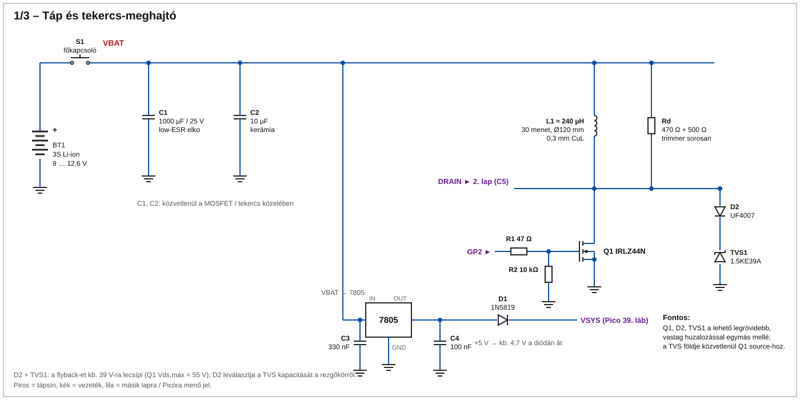
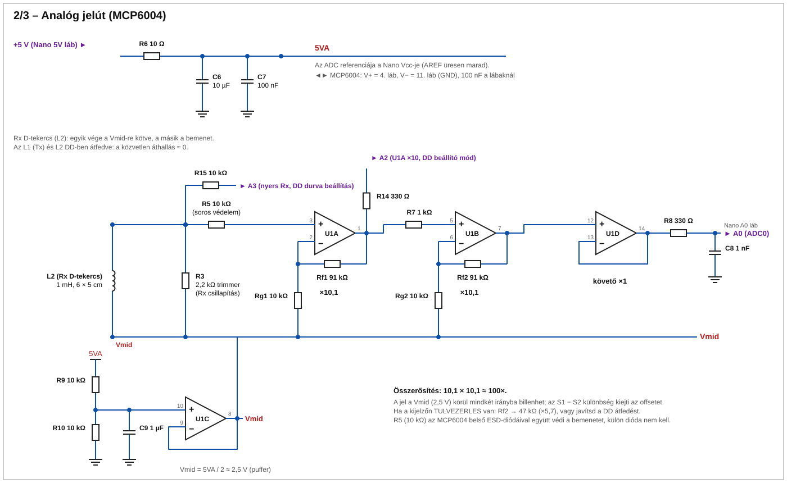
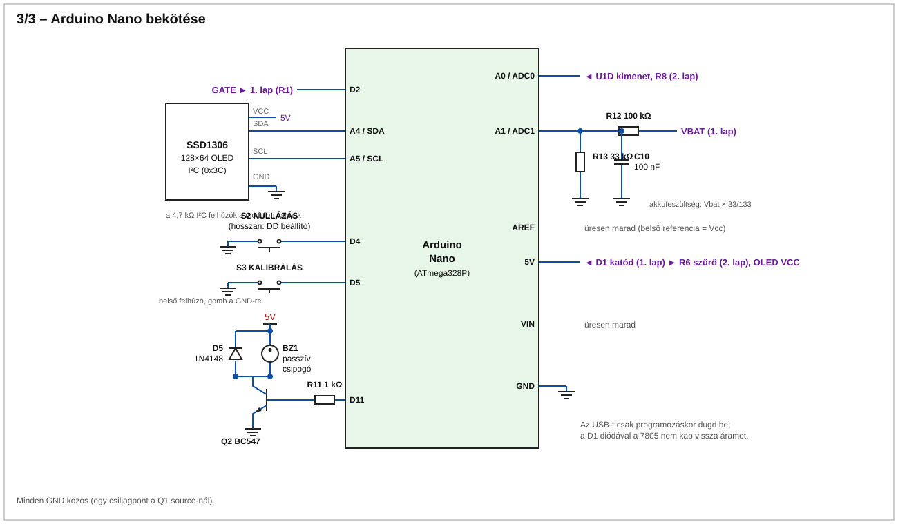
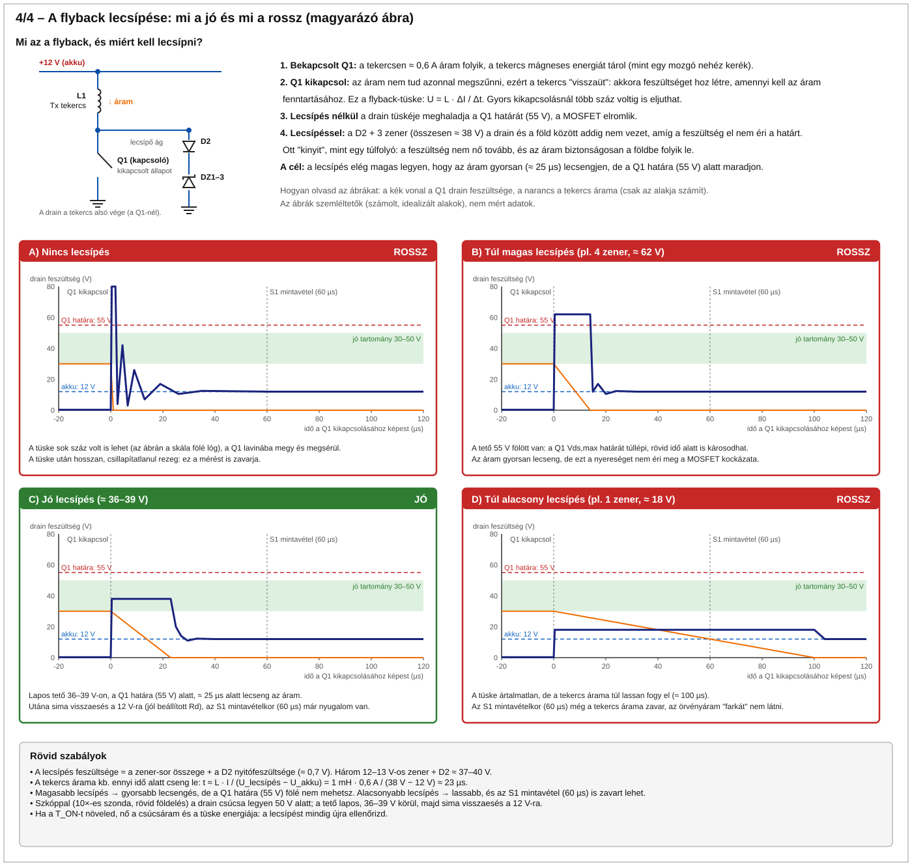

# Pulzusindukciós (PI) betonvas-kereső – Arduino Nano + DD tekercs + MCP6004 + IRLZ44N + SSD1306

Célmélység: 5–6 cm biztosan, 8 cm határeset (Ø8–12 mm betonvas, a tekercsek méretétől függően). Platform: **Arduino Nano (ATmega328P)**.

## Működés

1. Az IRLZ44N 60 µs-ra bekapcsol, a **Tx tekercs** (L1) árama ≈ 0,6 A-re nő (1 mH, 12 V mellett kb. 11 A/ms).
2. Kikapcsolásnál a flyback-feszültséget a zener-sor ~36–39 V-ra lecsípi, a tekercsáram kb. 30 µs alatt nullára esik.
3. A tranziens az `Rd` csillapítóval gyorsan lecseng. A fémben indukált örvényáram lassabban cseng le, ez a mérendő "farok".
4. A **külön Rx tekercs** (L2) az L1-gyel DD-ben (részben egymásra csúsztatva) van elhelyezve, így a közvetlen áthallás ≈ 0, és csak a fém által visszavert jel jut az erősítőbe.
5. A Nano 1 kHz-en ismétel, és impulzusonként két ponton mintavételez az ADC-vel: **S1** a kikapcsolás után 60 µs-mal, **S2** (alapvonal) 600 µs-mal.
6. Jel = S1 − S2, 100 impulzusra átlagolva (kb. 7 Hz kijelzőfrissítés). Ez kiejti az offsetet és a lassú driftet.
7. Indításkor automatikus nullázás (a kereső legyen levegőben). Az alapvonal lassan követi a driftet.
8. A kijelző oszlopot, számértéket és (kalibrálás után) becsült mélységet mutat. A csipogó hangmagassága a jellel nő.

### Gombok

Mindkét gomb a D-lábat földre húzza (belső felhúzással). A gombokat a mérés közben is figyeli a firmware, de a művelet a következő kijelzőfrissítéskor (kb. 0,1–0,2 s) hajtódik végre.

**D4 – NULLÁZÁS / beállító mód**

| Művelet | Normál (kereső) módban | DD beállító módban |
|---|---|---|
| Rövid nyomás (< 1 s), **felengedéskor** lép életbe | Újranullázás: a kijelzőn `Nullazas - legben!`, kb. 15 mérésen át (≈ 2 s) átlagolja a nullpontot és a zajszintet (a küszöb a zajhoz igazodik). Közben a kereső legyen levegőben, és ne legyen jelzés/csipogás. | Kilép a beállító módból, és újranulláz. |
| Hosszú nyomás (≥ 1 s), **még nyomva tartva** lép életbe | Belép a DD beállító módba (a `min` törlődik). | Nincs külön szerepe: a felengedéskor ugyanúgy kilép és újranulláz, mint a rövid nyomás. |

A mód váltását rövid (150 ms-os), 3 kHz-es csipogás jelzi. A hosszú nyomás után a gomb felengedése már nem indít újabb műveletet.

**D5 – KALIBRÁLÁS / `min` törlése**

DD beállító módban a D5 megnyomása törli a `min` értéket (eddigi legkisebb abszolút áthallás), és újra a következő mérésből indul. Kalibrálás beállító módban nem történik.

Normál módban:

1. Tarts egy vasat (a használt vastípust) pontosan **5 cm**-re a tekercstől, és nyomd a gombot: a kijelzőn `Kalibralas...`.
2. Tartsd lenyomva **1 másodpercig**. Ha a jel az érzékelési küszöb fölött van, a firmware eltárolja a `K = jel · 5³` értéket (az `S ≈ K/d³` modellre), az **EEPROM**-ba menti (kikapcsolás után is megmarad), 3 kHz-es csipogás hallatszik, és 1,5 s-ig `Kalibralva (5 cm)` látszik.
3. Ha 1 s után nincs érzékelt jel, a kalibrálás **nem** történik meg: `Nincs jel! Vas 5cm` (vagy túlvezérlésnél `Tulvezerles!`) jelenik meg. Hozd közelebb a vasat, és tartsd tovább nyomva a gombot; a mentés automatikusan megtörténik, amint van jel.
4. Nullázás közben (`Nullazas - legben!`) a kalibrálás nem indítható.

Kalibrálás nélkül a kijelzőn `nincs kal.` látszik, és mélység nem jelenik meg.

Mélység: d = ∛(K/S). Ez a mélység becslése, nem pontos mérés.

### Soros monitor (115200 baud)

Minden mérés (kb. 0,1–0,2 s) után egy sor jelenik meg, pl. `run diff=3.20 s1=512 s2=510 idle=511 zero=0.40 sig=2.80 vbat=11.8`. Az elején `run` (kereső) vagy `setup ch=A0` (DD beállító mód) áll. Az értékek ADC-egységben (0–1023) vannak, 100 impulzusra átlagolva.

| Mező | Jelentés |
|---|---|
| `s1` | Az első mintavétel átlaga az A0 bemeneten: a Tx kikapcsolása után 60 µs-mal (`T_SAMPLE1`). Ebben van a fém örvényáramának lecsengő jele. Nyugalmi értéke ≈ 512 (Vmid). 950 fölött vagy 70 alatt az erősítő telít, ekkor `TULVEZERLES`. |
| `s2` | Referencia (alapvonal) mintavétel átlaga: a kikapcsolás után 600 µs-mal (`T_SAMPLE2`), amikorra az örvényáram már lecsengett. Nyugalmi értéke szintén ≈ 512. |
| `diff` | `s1 − s2`, előjeles, simítva (exponenciális átlag: normál módban 0,3, beállító módban 0,1 súllyal; 60-nál nagyobb ugrásnál újraindul). Ez a nullázatlan jel. DD beállító módban ez látszik a kijelzőn. |
| `idle` | DC-ellenőrzés: az A0 értéke impulzus nélkül, 3 ms-mal a mérés után (8 minta átlaga). Nyugalmi értéke ≈ 512. Ha 900 fölött vagy 120 alatt van, a bemenet DC-szintje hibás, a kijelzőn `DC HIBA!` jelenik meg. |
| `zero` | A nullpont: a `diff` értéke levegőben, a nullázáskor átlagolva (15 mérés). Futás közben lassan követi a driftet (csak a küszöb alatti jel mellett). Beállító módban nem használt. |
| `sig` | A nullázott jel: `diff − zero`. A kijelzőn ennek abszolút értéke látszik, ez adja az oszlopot, a csipogó hangját és a mélységbecslést (`d = ∛(K/\|sig\|)`). Nullázás és beállító mód alatt 0. |
| `vbat` | Akkufeszültség (V), a belső 1,1 V-os referenciával korrigálva. |

### Miért elég a Nano?

A 10 bites, 5 V-os ADC lépése ≈ 4,9 mV. A ×100 erősítés miatt ez az Rx-nél ≈ 49 µV/LSB. A 100 impulzus átlagolása az ADC saját zajával együtt 0,1 LSB alá viszi a felbontást, ami a Pico valós (kb. 9 bites, 3,3 V-os) felbontásával egyenértékű. A mintavételi időzítést a Timer1 (0,5 µs) adja, az impulzus közben a megszakítások tiltva vannak.

## DD tekercsek

| Paraméter | Érték |
|---|---|
| Tekercsek | 2 db D-tekercs, egyenként 1 mH, 6 cm egyenes oldal, 5 cm D-magasság |
| Szerep | L1 = Tx (adó), L2 = Rx (vevő) |
| Elrendezés | az egyenes oldalaikkal részben egymásra csúsztatva (DD) |
| Csúcsáram (12 V / 60 µs) | ≈ 0,6 A (9 V-nál ≈ 0,45 A), a tekercs R-jétől függően |

**Mérd meg az L és R értéket** (a tekercs egyenáramú ellenállása sokat számít, ha 6 Ω fölött van, a csúcsáram kisebb lesz). Az átfedést a DD beállító móddal keresd meg, majd ragaszd/fixáld. A két tekercs síkja azonos legyen. Rövid, csavart, árnyékolt vezeték a vezérlőig.

### DD átfedés beállítása (firmware-es segítség)

1. Tartsd a keresőt levegőben, fémtől legalább fél méterre.
2. Tartsd lenyomva a **NULLÁZÁS** gombot 1 másodpercig: a kijelzőn `DD beallitas` jelenik meg.
3. A kereső és a DD beállító mód is az **A0** bemenetet használja, az U1D ×100 erősítésű kimenetéről. A kijelzőn a közvetlen áthallás látszik **előjelesen** (S1 − S2), alatta külön sorban a `min` (az eddigi legkisebb abszolút érték) és a nyers `S1` (nyugalmi értéke ≈ 512), legalul középre nullázott logaritmikus oszlop. A csipogó annál magasabb, minél nagyobb az áthallás, és elhallgat, ha az érték 1,5 alá esik (`NULL OK`).
4. Csúsztasd az egyik tekercset a másikhoz képest. Az érték **előjelet vált**, ezen a ponton kell a minimumot keresni. A kezdeti átfedés a D egyenes oldalának néhány mm–1,5 cm-e.
5. Ha megvan, rögzítsd a tekercseket, és nyomd meg röviden a gombot: a kereső kilép a módból, és újranulláz.

Ha az erősítő telítésbe megy (az S1 a 0 vagy 1023 közelében), a fejléc `TULVEZERLES`-re vált, a szám az S1 eltérése 512-től (az előjel megmutatja, merre telít), a csipogó mély, folyamatos hangot ad, és a `min` **nem frissül**. A telítés tehát nem számít jó minimumnak. Addig csúsztasd a tekercset, amíg a `TULVEZERLES` el nem tűnik, és az `S1` 512 körül van.

## Kapcsolási rajz

Három lapon (SVG, böngészőben vagy VS Code-ban megnyitható), plusz egy magyarázó ábra a lecsípésről ([4. lap](rajz/4_lecsipes_magyarazat.svg), lásd a Védelem szakaszt):

1. [Táp és tekercs-meghajtó](rajz/1_tap_es_meghajto.svg) – akku, 7805, Q1, Tx tekercs, Rd, zener-sor lecsípés
2. [Analóg jelút](rajz/2_analog_jelut.svg) – MCP6004: Rx tekercs bemenet és védelem, 2 × ×10 erősítő, Vmid, ADC-puffer
3. [Nano bekötése](rajz/3_nano_bekotes.svg) – OLED, gombok, csipogó, akkumérés, ADC





Az SVG-k a `rajz/gen.py` szkripttel generálódnak (`python rajz/gen.py`).

### Védelem

#### A lecsípés képekben: mi a jó és mi a rossz



Röviden: a Q1 kikapcsolásakor a tekercs árama nem tud azonnal megszűnni, ezért a tekercs nagy feszültségtüskét (flyback) ad. A D2 + zener-sor ezt a drain és a föld között ≈ 38 V-on "elvágja". A jó lecsípés elég magas ahhoz, hogy az áram ≈ 25 µs alatt lecsengjen, de a Q1 határa (55 V) alatt marad. Az ábra az A–D esetekkel megmutatja, mi történik lecsípés nélkül, túl magas és túl alacsony lecsípésnél.

- **Drain-oldal:** a flyback-et UF4007 (D2) + 3 db sorosan kötött zener (DZ1–DZ3, együtt 36–39 V) csípi le. Kisebb impulzusenergiánál (≈ 0,2 mJ) ez elég, de a zenerek feszültsége nagy áramnál megnő. Ezért a `T_ON` növelése előtt mindig ellenőrizd szkóppal, hogy a drain csúcsa **50 V alatt** marad (Q1 Vds,max = 55 V).
- **Rx-oldal:** külön védődióda nincs. A 10 kΩ soros ellenállás (R5) az MCP6004 belső ESD-diódáival együtt a megmaradó tüskét ≤ 2 mA-re korlátozza. A DD elrendezésnél az Rx jele eleve kicsi.

## Alkatrészlista

| Db | Alkatrész |
|---|---|
| 1 | Arduino Nano (ATmega328P) |
| 1 | MCP6004 (DIP14 vagy SOIC14) |
| 1 | IRLZ44N |
| 1 | SSD1306 128×64 I2C OLED |
| 1 | L7805 (TO-220) |
| 2 | D-tekercs, 1 mH (Tx és Rx) |
| 3 | zener 12–13 V, ≥ 1 W (DZ1–DZ3, sorosan) |
| 1 | UF4007 (D2), 1 db 1N5819 (D1), 1 db 1N4148 (D5) |
| 1 | 1000 µF/25 V low-ESR, 10 µF kerámia |
| 1 | BC547 (csipogóhoz), passzív csipogó |
| – | Ellenállások: 10 Ω, 47 Ω, 330 Ω ×2 (R8, R14), 1 kΩ ×2 (R7, R11) + Rd 1 kΩ, 10 kΩ ×7 (R2, R5, R9, R10, R15, Rg1, Rg2), 33 kΩ, 91 kΩ ×2, 100 kΩ |
| 2 | trimmer: 1 kΩ (Rd), 2,2 kΩ (R3, Rx csillapítás) |
| – | Kondenzátorok: 330 nF, 100 nF ×4 (C4, C7, C10 + MCP6004 lábnál), 1 nF, 1 µF, 10 µF ×2 |
| 2 | nyomógomb, főkapcsoló |

## Beüzemelés (ebben a sorrendben)

1. Első bekapcsolás a **tekercsek és az Rx jelút nélkül**: ellenőrizd a táp- és meghajtó-oldalt.
   - **Előkészítés:** a Tx tekercset és az Rx jelutat még ne kösd be. Az `Rd`-t és a zener-sort szereld be, a Nano programozva legyen (a gate-et ő vezérli). Az első próbákhoz használj kis `T_ON`-t (pl. 10–20 µs).
   - **Táp:** állítsd az akku/laborasztal feszültségét 9–12 V-ra, lehetőleg áramkorlátos tápról (pl. 100–200 mA). Mérd meg a 7805 kimenetét: **5,0 V ± 0,1 V**, és hogy az áramfelvétel nyugalomban kicsi (a Nano és a kijelző kb. 30–50 mA).
   - **Drain-mérés:** szkóppal (10×-es szonda, rövid földelés) nézd a Q1 drainjét. Flyback csak induktív terheléssel van, ezért erre a méréshez ideiglenesen kösd be a Tx tekercset (a jelút továbbra is maradjon üresen). Az impulzus alatt a drain kb. 0 V, kikapcsoláskor feszültségtüske jön.
   - **Elvárás:** a tüske csúcsa a zener-sor miatt **≈ 36–39 V**, és **50 V alatt** marad (Q1 Vds,max = 55 V). Ha ennél magasabb, ne növeld a `T_ON`-t, és ellenőrizd a zenereket, az UF4007-et és a bekötést.
   - **Hiba esetén:** ha a gate nem billen, ellenőrizd a 47 Ω soros ellenállást, a 10 kΩ lehúzót és a D2 jelet. Ha a Q1 vagy a zener melegszik, azonnal kapcsold le.
2. Kösd be a Tx tekercset (az Rx és a jelút még maradjon üresen), és állítsd be az `Rd` csillapítást:
   - **Mi ez:** az `Rd` (1 kΩ fix + 1 kΩ trimmer sorosan, tehát 1–2 kΩ) a Tx tekerccsel párhuzamosan van kötve. Kikapcsoláskor a tekercs és a parazita kapacitások (tekercs, Q1, szerelés) rezgőkört alkotnak. Az `Rd` ezt csillapítja.
   - **Mérés:** szkóppal a Q1 **drainjén** nézd a kikapcsolás utáni lecsengést (10×-es szonda, a földcsipesz a lehető legrövidebben a Q1 source-ához). Triggerelj a gate lefutó élére, az időalap 5–10 µs/osztás legyen. Közben a csúcs maradjon **50 V alatt**.
   - **Beállítás:** a trimmert a maximumról (2 kΩ) indulva csökkentsd, amíg a jel a leggyorsabban, **túllövés és visszarezgés nélkül** éri el az alapszintet (kritikus csillapítás).
     - Túl nagy `Rd`: alulcsillapított, a jel az alapvonal körül **rezeg**, a lecsengés elhúzódik.
     - Túl kis `Rd`: túlcsillapított, a jel nem rezeg, de **lassan közelít** az alapszinthez, és a tekercs árama is jobban terheli az `Rd`-t.
   - **Elvárás:** 1 mH-nál ez általában 1–2 kΩ körül van. A tekercs kapacitása és a szerelés miatt a pontos érték eltérhet, ezért mérd meg. Ha a lecsengés még így sem fejeződik be 60 µs-ig, a `T_SAMPLE1` növelése is szükséges (lásd az 5. pontot).
   - Ezután a trimmer álljon úgy, ahogy van: az `Rd` módosítása után az Rx csillapítását (3. pont) újra kell ellenőrizni.
3. Kösd be a jelutat az Rx tekerccsel, és állítsd be az Rx csillapítást (`R3`).
   - **Bekötés:** az Rx tekercs (L2) egyik vége a **Vmid**-re (≈ 2,5 V), a másik a bemeneti hálózatra kerül: `R3` (2,2 kΩ trimmer) a Vmid felé csillapít, `R5` (10 kΩ) soros védelem az MCP6004 bemenete előtt. Az Rx a Tx-től független, a DD átfedés most még durván legyen beállítva.
   - **Nyugalmi szint:** a tekercsek levegőben, fémtől távol az A0 nyugalmi értéke kb. **2,5 V** legyen. A soros monitoron `s1` ≈ 512 és `s2` ≈ 512 (kb. ±30; lásd a Soros monitor szakaszt). Ha ez jelentősen eltér, ellenőrizd a Vmid-et (R9/R10, U1C), a tápot és az MCP6004 bekötését.
   - **Mérés:** szkóppal az **U1A kimenetén (1. láb)** nézd, hogyan cseng le a jel a Tx kikapcsolása után. Triggerelj a gate lefutó élére (kb. 5–10 µs/osztás, majd 50–100 µs/osztás), és tarts egy vasat a tekercshez, hogy a lecsengés jól látszódjon.
   - **Beállítás:** az `R3` trimmert állítsd úgy, hogy az Rx tekercs rezgése a leggyorsabban, **túllövés nélkül** csengjen le (kritikus csillapítás).
     - Túl nagy érték: az Rx rezeg, a jel elhúzódik.
     - Túl kis érték: a jel gyorsan lecseng, de **csökken az érzékenység** (kisebb a farok).
     - Elvárás: a jel a kikapcsolás után **60 µs-mal** (`T_SAMPLE1`) már közel az alapszinten legyen. Ha nem, az 5. pontnál a `T_SAMPLE1`-et kell növelni.
   - **Ellenőrzés:** az `Rd` vagy `R3` módosítása után a 2. és 3. pontot is ellenőrizd újra, mert a két csillapítás hat egymásra.
4. A DD beállító móddal állítsd az átfedést minimális áthallásra (lásd fent), és rögzítsd.
5. Nézd meg az U1A kimenetén (1. láb), mikor ér vissza a jel az alapszintre. Ha 60 µs-nál később, a `T_SAMPLE1`-et növeld ([config.h](src/config.h)).
6. Tarts egy vasat a tekercshez: a jel nőjön. Az `abs()` miatt a polaritás nem számít, de a soros monitoron (`sig`) látod.
7. Ha telít (`TULVEZERLES`), javítsd az átfedést, vagy a második fok Rf-jét cseréld 47 kΩ-ra.
8. Kalibrálás 5 cm-nél, majd ellenőrzés 6 és 8 cm-nél.

## Ismert kockázatok

- Az MCP6004 (1 MHz GBW) túlvezérlésből felépülése lassú lehet. A DD elrendezés és az R5 soros ellenállás ezt enyhíti, de a mintavételi késleltetést a mérésed alapján kell beállítani.
- A kis tekercsek (≈ 6 × 10 cm) miatt a 8 cm határeset, főleg vékonyabb vasnál és betonban.
- A szám-értékek (`DETECT_TH`, `FULL_SCALE`, `T_SAMPLE1`) számolt/javasolt értékek, a prototípuson hangolni kell.
- Az akku/tekercsáram tápingadozása az alapvonalba megy, akkucsere után nullázz újra.
- A 7805 mellett a 3S akku legalább ~7,5 V-ig működik; 9 V alatt az akkut töltsd.
- A watchdog (1 s) lefagyás esetén újraindítja a Nanót, a 10 kΩ lehúzó (R2) a gate-et addig is alacsonyan tartja. A régi (57600 baudos) bootloaderes Nanók watchdog-reset után megállhatnak, ilyenkor elég kikapcsolni és újra bekapcsolni, vagy a `USE_WATCHDOG`-ot 0-ra kell állítani.

## Fordítás

```
pio run                      # régi bootloaderes Nano (nano környezet)
pio run -e nano_newboot      # új (115200 baudos) bootloader
pio run -t upload            # feltöltés
```
Az USB-t csak programozáskor dugd be, a D1 dióda megakadályozza, hogy az USB-ről a 7805 áramot kapjon vissza.
