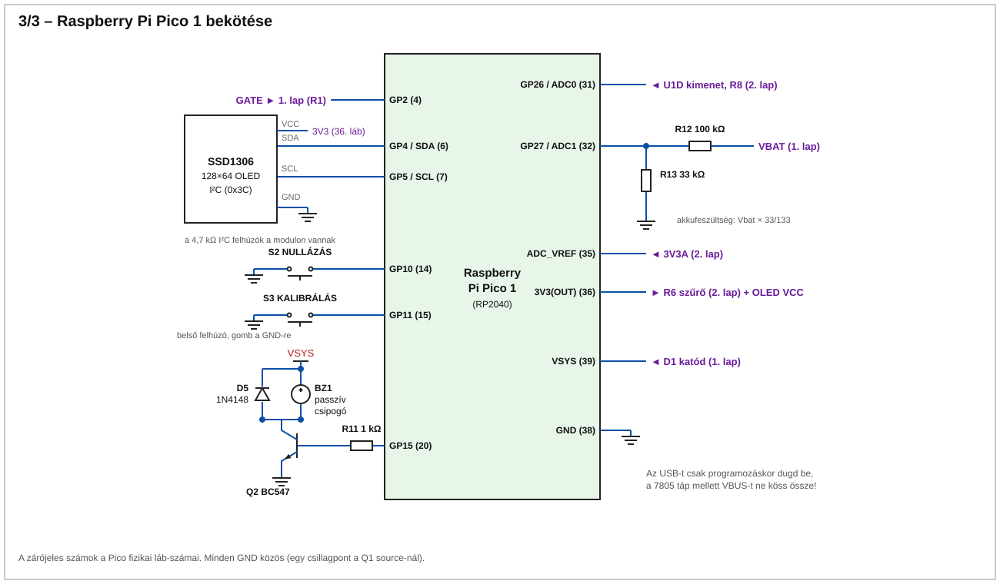

# Pulzusindukciós (PI) betonvas-kereső – Pico + MCP6004 + IRLZ44N + SSD1306

Célmélység: 5–8 cm (Ø8–12 mm betonvas). Platform: **Raspberry Pi Pico (RP2040)** – a Pico2 ADC-hiba (RP2350-E9) miatt nem Pico2.

## Működés

1. Az IRLZ44N 60 µs-ra bekapcsol, a tekercsáram ≈ 2 A-re nő.
2. Kikapcsolásnál a flyback-feszültséget a TVS ~39 V-ra lecsípi, a tekercsáram ~20 µs alatt nullára esik.
3. A tranziens az `Rd` csillapítóval gyorsan lecseng. A fémben indukált örvényáram lassabban cseng le, ez a mérendő "farok".
4. A Pico (core1) 1 kHz-en ismétel, és impulzusonként két ponton mintavételez az ADC-vel: **S1** a kikapcsolás után 50 µs-mal, **S2** (alapvonal) 600 µs-mal.
5. Jel = S1 − S2, 100 impulzusra átlagolva (10 Hz). Ez kiejti az offsetet és a lassú driftet.
6. Indításkor automatikus nullázás (a kereső legyen levegőben). Az alapvonal lassan követi a driftet.
7. A kijelző oszlopot, számértéket és (kalibrálás után) becsült mélységet mutat. A csipogó hangmagassága a jellel nő.

Gombok: **GP10** = újranullázás. **GP11** hosszan (1 s) nyomva, miközben egy vasat pontosan 5 cm-re tartasz = kalibrálás (a `S ≈ K/d³` modellre, EEPROM-ba mentve).
Mélység: d = ∛(K/S). Ez a mélység becslése, nem pontos mérés.

## Tekercs

| Paraméter | Érték |
|---|---|
| Huzal | 0,3 mm CuL |
| Átmérő (átlag) | 120 mm |
| Menetszám | 30 |
| L (számolt) | ≈ 240 µH (mérd meg, ±20% eltérés belefér) |
| R | ≈ 2,8 Ω |
| Csúcsáram (12 V / 60 µs) | ≈ 2 A (9 V-nál ≈ 1,6 A) |

Egyetlen közös Tx/Rx tekercs. Szorosan, egy rétegben tekerd, ragaszd/fixáld. Rövid, csavart, árnyékolt vezeték a vezérlőig. Ha a mélység kevés, a menetszám csökkentésével (kisebb L) a Ton növelhető, vagy a tekercs átmérője nagyítható.

## Kapcsolási rajz

Három lapon (SVG, böngészőben vagy VS Code-ban megnyitható):

1. [Táp és tekercs-meghajtó](rajz/1_tap_es_meghajto.svg) – akku, 7805, Q1, tekercs, Rd, flyback-lecsípés
2. [Analóg jelút](rajz/2_analog_jelut.svg) – MCP6004: bemeneti csatolás és védelem, 2 × ×10 erősítő, Vmid, ADC-puffer
3. [Pico bekötése](rajz/3_pico_bekotes.svg) – OLED, gombok, csipogó, akkumérés, ADC




Az SVG-k a `rajz/gen.py` szkripttel generálódnak (`python rajz/gen.py`).

## Alkatrészlista

| Db | Alkatrész |
|---|---|
| 1 | Raspberry Pi Pico (nem Pico2) |
| 1 | MCP6004 (DIP14 vagy SOIC14) |
| 1 | IRLZ44N |
| 1 | SSD1306 128×64 I2C OLED |
| 1 | L7805 (TO-220) + 330 nF, 100 nF |
| 1 | UF4007, 1 db 1N5819, 1 db 1N4148 |
| 1 | TVS 1.5KE39A (egyirányú) |
| 1 | BAT54S (vagy 2× BAT54) |
| 1 | 1000 µF/25 V low-ESR, 10 µF kerámia |
| 1 | BC547 (csipogóhoz) |
| – | Ellenállások: 10 Ω, 47 Ω, 330 Ω, 1 k ×3 (R5, R7, R11), 2,2 k, 10 k ×4, 22 k ×2, 33 k, 91 k ×2, 100 k; Rd = 470 Ω + 500 Ω trimmer |
| – | Kondenzátorok: 100 nF/50 V X7R (C5), 1 nF, 1 µF, 10 µF, 100 nF ×2 |
| 2 | nyomógomb, főkapcsoló |

## Beüzemelés (ebben a sorrendben)

1. Tekercs nélkül vagy a kész tekerccsel, **az ADC-s jelút nélkül** nézd oszcilloszkóppal a drain-t: a lecsípés ≤ 40 V legyen, a csúcsáram ~2 A.
2. Állítsd az `Rd` trimmert kritikus csillapításra: a leggyorsabb lecsengés túllövés nélkül.
3. Nézd meg, mikor ér vissza a drain az alapszintre. Ha 50 µs-nál később, a `T_SAMPLE1`-et növeld, vagy a `T_ON`-t csökkentsd ([main.cpp](src/main.cpp) tetején).
4. Kösd be a jelutat. A kimenet nyugalmi értéke ~1 V legyen, és ne legyen telítésben (a kijelzőn `TULVEZERLES`). Ha telít, a második fok Rf-jét cseréld 47 k-ra.
5. Tarts egy vasat a tekercshez: a jel nőjön. Ha minden vas a "nullánál" kisebb értéket ad, az `abs()` miatt ez nem gond, de a polaritást a soros monitoron (`sig`) is látod.
6. Kalibrálás 5 cm-nél, majd ellenőrzés 8 cm-nél.

## Ismert kockázatok

- Az MCP6004 (1 MHz GBW) túlvezérlésből felépülése lassú lehet. Ezt a BAT54S és a 2,2 k + 1 k soros ellenállás enyhíti, de a mintavételi késleltetést a mérésed alapján kell beállítani.
- Az akku/tekercsáram tápingadozása az alapvonalba megy, akkucsere után nullázz újra.
- A 7805 mellett a 3S akku legalább ~7,5 V-ig működik; 9 V alatt az akkut töltsd.
- A watchdog (1 s) lefagyás esetén lehúzza a gate-et, így a MOSFET és a tekercs nem éghet ki.
- A rajz és az értékek számolt/javasolt értékek, a prototípuson hangolni kell.

## Fordítás

```
pio run          # firmware.uf2: .pio/build/pico/firmware.uf2
```
A Pico BOOTSEL módjában másold fel az UF2-t.


